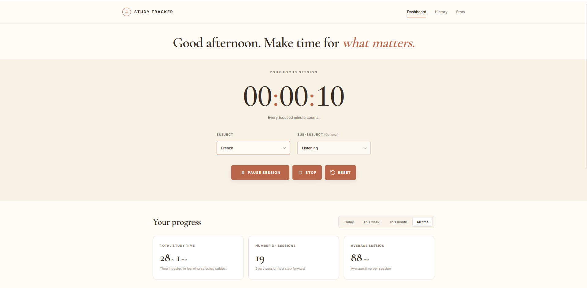

# Study Tracker

An application for tracking and analyzing time spent studying. The project is currently under development and includes a web interface and an API connected to PostgreSQL.

## Screenshots



## Current Features

- Start, pause, resume, and finish study sessions, or log sessions manually.
- Organize study activities by subjects and subtopics.
- View a dashboard with total study time, recent sessions, and the most active subjects.
- Browse study history with filters by subject and date range, with individual entries or sessions grouped by day, week, or month.
- Edit and delete sessions, subjects, and subtopics.

## Technologies

- **Frontend:** React, Vite, and React Router.
- **Backend:** Python 3.13+, FastAPI, SQLAlchemy, and Alembic.
- **Database:** PostgreSQL.

## Local Setup

Requirements: Python 3.13+, [uv](https://docs.astral.sh/uv/), Node.js with npm, and Docker Compose.

1. Create the environment files from the provided examples: `.env.example` in the project root and `frontend/.env.example` in `frontend/`. Adjust the values if necessary.

2. From the project root, install the dependencies and start PostgreSQL:

   ```bash
   uv sync
   docker compose up -d
   ```

3. Apply the database migrations and start the API:

   ```bash
   uv run alembic upgrade head
   uv run uvicorn study_tracker.main:app --reload
   ```

   The API and its interactive documentation will be available at `http://localhost:8000` and `http://localhost:8000/docs`.

4. In a separate terminal, install the frontend dependencies and start the development server:

   ```bash
   cd frontend
   npm install
   npm run dev
   ```

   Vite will display the local application URL. The API URL is configured through `VITE_API_BASE_URL` in `frontend/.env`.

## Tests

From the project root, run:

```bash
uv run pytest
```